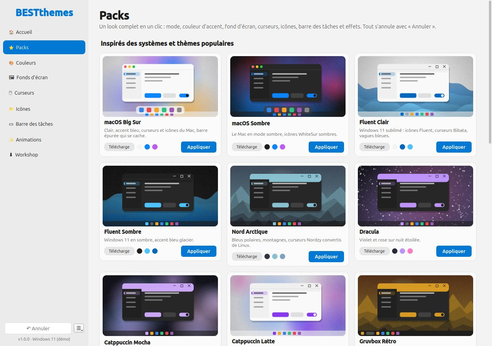
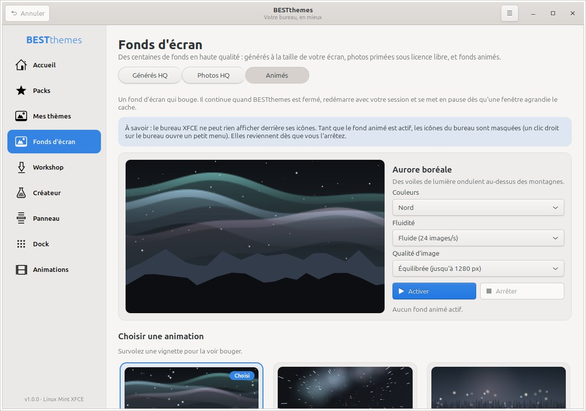
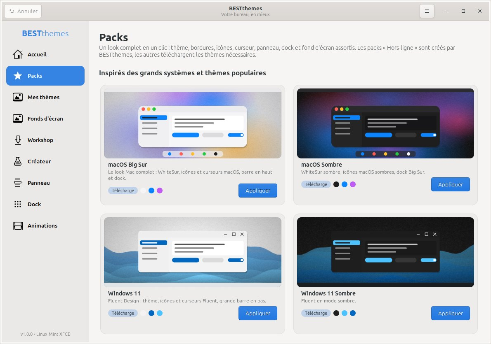
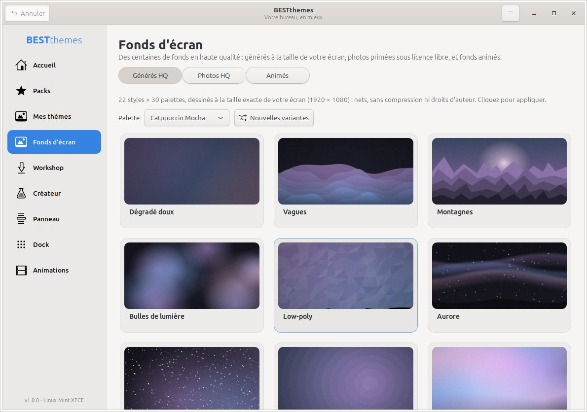
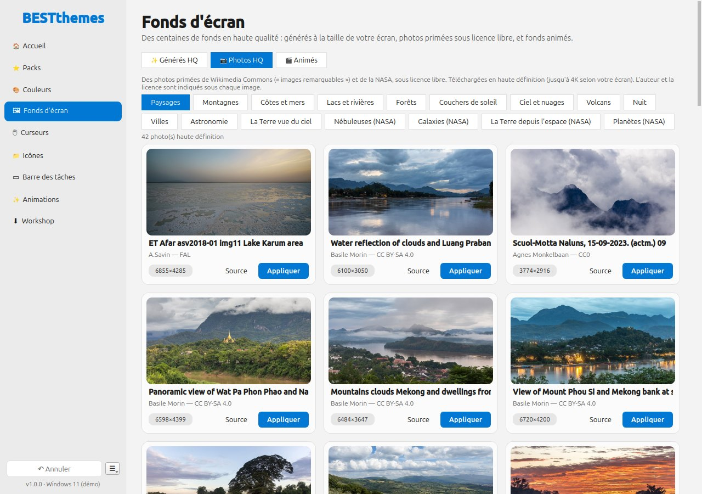
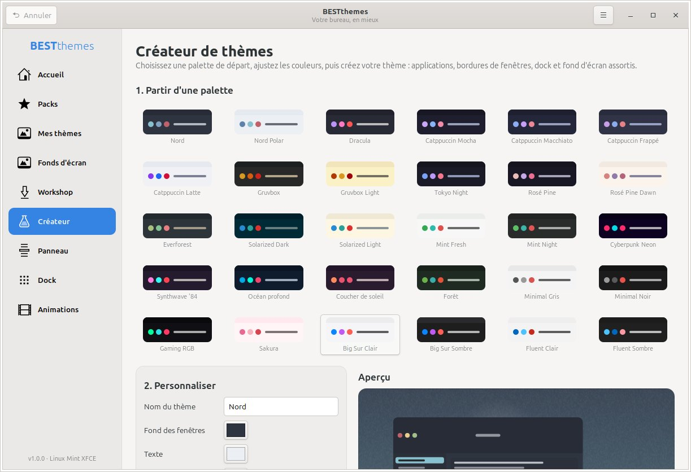

<h1 align="center">BESTthemes</h1>

<p align="center">
  <b>Customize your desktop in a few clicks — without ever opening a terminal.</b><br>
  Themes, icons, cursors, taskbar/panel, dock, HD &amp; animated wallpapers, all in one app.<br>
  Every change can be undone.
</p>

<p align="center">
  <a href="https://github.com/t0xiclibre-gif/BESTthemes/releases/latest"></a>
  
  <a href="LICENSE"></a>
</p>

<p align="center">
  
  
</p>

> **Language:** the interface is currently in **French**. Translations are welcome — see [Contributing](#contributing).

---

## Contents

- [Features](#features)
- [Install on Windows](#install-on-windows)
- [Install on Linux Mint XFCE](#install-on-linux-mint-xfce)
- [Safe by design](#safe-by-design)
- [Screenshots](#screenshots)
- [Run from source](#run-from-source)
- [Build the packages](#build-the-packages)
- [Project structure](#project-structure)
- [Contributing](#contributing)
- [Credits & license](#credits--license)

## Features

| | Windows 10 / 11 | Linux Mint XFCE |
|---|---|---|
| **One-click packs** | 20 complete looks (macOS, Fluent, Nord, Dracula, Catppuccin, Gruvbox, Synthwave, Gaming…): dark/light mode, accent color, wallpaper, cursors, icons, taskbar, effects | 21 complete looks: GTK theme, window borders, icons, cursor, panel, Plank dock, wallpaper |
| **HD wallpapers** | 22 styles generated at your exact screen resolution (up to 4K) × 30 color palettes | same |
| **Photo gallery** | Award-winning photos from Wikimedia Commons (*Featured pictures*) and NASA, freely licensed, downloaded in Full HD or 4K, author credited | same |
| **Animated wallpapers** | 13 scenes (aurora, space travel, fireflies, waves, rain, snow, synthwave, code rain, nebula…) **behind your desktop icons**, restart with Windows, pause automatically when a maximized window or full-screen game covers them | same scenes; restart with your session, pause behind maximized windows |
| **Cursors** | Windows cursor themes (.inf/.cur/.ani) **and Linux cursor themes converted automatically**, cursor size | Installed cursors with preview, cursor size |
| **Icons** | Linux icon packs (Papirus, WhiteSur, Tela…) converted to `.ico` for This PC, Recycle Bin, Network, Documents, Pictures, Music, Videos, Downloads, Desktop | Installed icon themes with preview |
| **Taskbar / panel** | 5 layouts, alignment, search, widgets, grouping, auto-hide, Start menu, classic right-click menu (Win 11) | 8 panel layouts (Windows, macOS, Ubuntu, GNOME, ChromeOS…), position, size, opacity, auto-hide, dark mode |
| **Window effects** | Window/menu animations, fades, shadows, menu delay — 4 presets | Compiz effects including the *magic lamp* (optional) |
| **Workshop** | Curated selection + live search on xfce-look.org (cursors, icons, wallpapers) + 9 tools installed in one click with winget (TranslucentTB, Nexus Dock, Windhawk, Lively Wallpaper, Rainmeter, Flow Launcher, PowerToys, ExplorerPatcher, StartAllBack) | 59 tested themes (xfce-look.org + GitHub) + live search across thousands of themes on xfce-look.org: download, extract, install and apply automatically |
| **Theme creator** | Palette + wallpaper style → full "ambiance" (mode, accent, wallpaper) | 30 palettes, 4 window button styles → complete GTK 3 + xfwm4 + Plank theme |
| **Dock** | via Nexus Dock (Workshop → Tools) | Installs and configures Plank (password asked in a graphical prompt) |

## Install on Windows

**Requirements:** Windows 10 or 11, 64-bit. No administrator rights needed.

1. Go to the [**latest release**](https://github.com/t0xiclibre-gif/BESTthemes/releases/latest).
2. Download **one** of these:
   - **`BESTthemes-Portable-x.y.z.exe`** — a single file, nothing to install. Run it from anywhere, even a USB stick.
   - **`BESTthemes-Setup-x.y.z.exe`** — a classic installer: Start menu and desktop shortcuts, uninstall from *Settings → Apps*.
3. Double-click it. The first start of the portable version takes a few seconds (it unpacks itself).

> **"Windows protected your PC"?** The executables are not code-signed yet, so SmartScreen warns about them.
> Click **More info → Run anyway**. You can check the file against the SHA-256 checksums listed in the release notes.

**Good to know**

- Settings and undo history are stored per PC in `%LOCALAPPDATA%\BESTthemes`.
- Animated wallpapers restart with Windows. If you use the portable version, keep the `.exe` in the same place (not on a USB stick you unplug).
- If something goes wrong, the portable version writes `BESTthemes-journal.txt` (and `BESTthemes-fond-anime-journal.txt` for the animated wallpaper) next to the `.exe`. Please attach them to your [bug report](https://github.com/t0xiclibre-gif/BESTthemes/issues).
- **What Windows does not allow** (and BESTthemes refuses to hack): full window-border themes (they require patching system files with tools like SecureUxTheme/UltraUXThemePatcher, which can break after Windows updates), and changing *every* system icon without admin rights. The Windhawk tool (Workshop → Tools) offers safe, reversible mods if you want to go further.

**Uninstall:** delete the portable `.exe`, or use *Settings → Apps → BESTthemes* for the installed version. To get your previous look back first, use ☰ → *Restaurer Windows d'origine* (restore original Windows).

## Install on Linux Mint XFCE

**Requirements:** Linux Mint 21/22 XFCE (or another XFCE distribution based on Ubuntu/Debian). All dependencies ship with Linux Mint XFCE.

### The easy way (no terminal)

1. Download **`bestthemes_x.y.z_all.deb`** from the [**latest release**](https://github.com/t0xiclibre-gif/BESTthemes/releases/latest).
2. Double-click the file, then click **Install Package** and enter your password.
3. Open **BESTthemes** from the menu, under **Settings** (*Paramètres*).

### With a terminal

```sh
cd ~/Downloads
sudo apt install ./bestthemes_*_all.deb
bestthemes
```

**Uninstall:** `sudo apt remove bestthemes` (or use the Software Manager / Synaptic). To get your previous look back first, use ☰ → *Restaurer mon bureau d'origine* (restore my original desktop).

**Good to know**

- Themes are installed in your home folder (`~/.themes`, `~/.icons`, `~/.local/share/plank/themes`): no password needed, except to install Plank or the optional Compiz effects.
- **Animated wallpapers on XFCE:** the XFCE desktop (xfdesktop) cannot draw anything behind its icons, so while an animated wallpaper is running it replaces the desktop — **desktop icons are hidden** (right-click the desktop for a small menu). They come back as soon as you stop the animation.
- Optional packages: `plank` (dock), `zstd` (some theme archives), `gir1.2-wnck-3.0` (pauses the animated wallpaper behind maximized windows).

## Safe by design

- **Undo everything.** Before each change, your current configuration is saved. The **Annuler** (Undo) button goes back up to 40 steps, and the ☰ menu → **Restaurer … d'origine** (Restore original) puts everything back exactly as it was the first time you opened BESTthemes.
- **No system files are modified.** On Windows, only per-user settings (HKCU registry, your own folders) are changed; on Linux, only your XFCE settings and home folder.
- **Archives are extracted safely:** path traversal, absurd sizes and "zip bombs" are rejected.
- Downloads come from their official sources (xfce-look.org/pling.com, GitHub, Wikimedia Commons, NASA, winget).

## Screenshots

| Linux Mint XFCE | Windows 11 |
|---|---|
|  |  |
|  |  |
|  |  |

## Run from source

```sh
git clone https://github.com/t0xiclibre-gif/BESTthemes.git
cd BESTthemes
```

**Linux** (Python 3.10+, PyGObject/GTK 3, pycairo, requests, xfconf — all preinstalled on Mint XFCE):

```sh
python3 -m bestthemes                         # start the app
python3 -m unittest discover -s tests -t .    # tests (they never touch your real desktop)
```

**Windows** (Python 3.11+):

```bat
pip install -r windows\requirements.txt
python windows\launcher.py
```

The Windows version also runs on Linux/macOS in **demo mode** (simulated registry, nothing is changed), which is handy for development:

```sh
pip install -r windows/requirements.txt
python windows/launcher.py
python -m unittest discover -s windows/tests -t windows
```

> ⚠️ On Windows the Windows test suite changes real settings of the current session: run it on a test machine or in CI.

## Build the packages

| Package | Command |
|---|---|
| Linux `.deb` | `packaging/build_deb.sh` → `dist/bestthemes_<version>_all.deb` |
| Windows installer + portable `.exe` | on Windows with Python 3.12 and [Inno Setup 6](https://jrsoftware.org/isinfo.php): double-click `windows\packaging\build.bat` |
| Everything, automatically | push a tag `vX.Y.Z`: GitHub Actions tests both versions, builds the `.deb`, the installer and the portable `.exe`, and attaches them to the release |

## Project structure

```
bestthemes/              Linux app (GTK 3) and the shared engine
  core/                  xfconf, theme detection, apply/undo, safe archive install, panel, Plank,
                         theme & wallpaper generators, photo gallery, animated scenes (live.py)
  workshop/              built-in catalog + xfce-look.org / pling.com API
  ui/                    one file per page, previews drawn with Cairo
  data/                  palettes, packs, GTK 3 CSS template, app style
  live_player.py         animated wallpaper player (`bestthemes --live`, separate process)
windows/
  bestthemes_win/        Windows app (Qt / PySide6) — reuses the shared engine above
    core/                registry, cursors (incl. Linux → Windows conversion), icons, taskbar,
                         effects, packs, Workshop, animated wallpaper control
    ui/                  pages
    live_player.py       animated wallpaper player placed behind the desktop icons
  packaging/             PyInstaller specs, Inno Setup script, build.bat
packaging/               Debian package (control, launcher, .desktop, icon)
tests/, windows/tests/   unit tests
```

## Contributing

Contributions are very welcome!

- **Bugs & ideas:** open an [issue](https://github.com/t0xiclibre-gif/BESTthemes/issues). For Windows bugs, please attach the journal files mentioned above and your Windows version (`winver`).
- **Translations:** the UI is in French for now; help to make it translatable (English first) is especially appreciated.
- **New themes for the Workshop:** add them to `bestthemes/workshop/catalog.json` (Linux) or `windows/bestthemes_win/data/catalog_win.json` (Windows) with their official download source.
- **Pull requests:** keep the "no terminal, everything undoable" spirit, and run both test suites before submitting.

## Credits & license

BESTthemes is free software, released under the **GNU General Public License v3.0 or later** — see [LICENSE](LICENSE).

Themes, icons and cursors downloaded through the Workshop belong to their respective authors and are fetched from their official pages (xfce-look.org / pling.com, GitHub). Gallery photos come from [Wikimedia Commons](https://commons.wikimedia.org/wiki/Commons:Featured_pictures) (each under its own free license, author and license shown in the app and saved next to the image) and from the [NASA Image Library](https://images.nasa.gov) (public domain). BESTthemes is not affiliated with Microsoft, Apple, Linux Mint, XFCE, Wikimedia or NASA.
